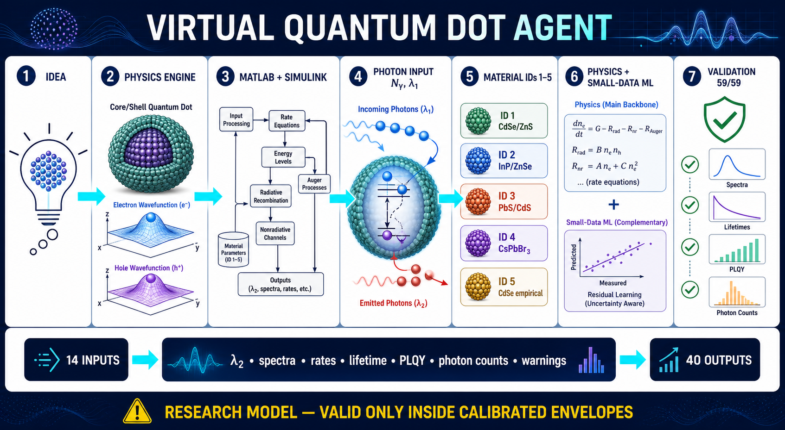

# Virtual Quantum Dot Agent — Complete Conversation and Project Summary

**Final documented release:** 1.5.1  
**Environment:** MATLAB R2026a Update 4 and Simulink  
**Summary date:** 30 August 2026  
**Main model:** `VirtualQuantumDotAgent.slx`



*The infographic records the project through v1.4 and therefore shows the
then-current 59/59 checks. The v1.5.1 ensemble/publication audit below raises
the frozen total to 73/73 and is visualized separately in
`QDEnsembleObservationDemo.png`.*

## 1. Original goal

The conversation began with a proposal to build a quantum-dot physics engine in
MATLAB and expose it as a callable scientific tool. The key design principle was
to keep the physical equations in MATLAB/Simulink and let an agent control,
query, compare and optimize the simulator. The requested final object was a
virtual quantum dot whose outputs change when its material, size, environment,
excitation or target changes.

The original architecture was therefore:

```text
user or agent request
        -> input parameters and material database
        -> quantum-dot physics engine
        -> time-dependent Simulink dynamics
        -> spectra, rates, populations and photon predictions
        -> accuracy checks and next-design suggestion
```

This physics-first design was retained throughout the project. Machine learning
was later added only where measured data justified it; it did not replace the
physical backbone.

## 2. What was built

The result is a working, input-dependent MATLAB/Simulink digital twin and
inverse-design tool. The delivered Simulink interface was deliberately kept
stable at **14 physical inputs and 40 physical/diagnostic outputs**, so later
calibration and ML improvements did not break the model diagram.

The engine implements:

- temperature-dependent bulk band gap using a Varshni relation;
- finite spherical electron and hole wells with mass-discontinuous
  BenDaniel–Duke boundary matching;
- electron and hole confinement energies;
- effective exciton Coulomb attraction and dielectric-polarization shift;
- electric-field Stark shift and field-reduced electron-hole overlap;
- hydrostatic strain and geometric dilation;
- optical absorption, photoluminescence energy and wavelength spectra;
- radiative, nonradiative, surface-trap, thermal-escape, Auger and WKB
  tunnelling channels;
- a four-state continuous-time master equation for ground, exciton,
  biexciton and trapped populations;
- exact matrix-exponential propagation and event-count integration on each
  constant-input interval; and
- an inverse-design controller that suggests a radius for a requested emission
  energy.

The main energy construction is conceptually:

```text
Eabs = Eg(T) + Ee + Eh - J_eh + Epolarization + Estrain + EStark
EPL  = Eabs - EStokes
lambda2_nm = 1239.841984 / EPL_eV
```

For material IDs 2–4, the unperturbed absorption term is replaced by a
published, material-specific baseline. Field, strain, dielectric and barrier
changes are then applied as mechanistic deltas. This is a hybrid empirical-plus-
physics path, not an atomistic calculation.

## 3. Inputs and outputs

The fixed 14-element Simulink input vector contains:

1. core radius;
2. temperature;
3. electric field;
4. hydrostatic strain;
5. pump intensity;
6. pump photon energy;
7. shell thickness;
8. surface-trap density;
9. environment dielectric constant;
10. electron barrier;
11. hole barrier;
12. target emission energy;
13. material ID; and
14. Stokes-shift override.

The 40 outputs cover electronic energies, absorption and PL, `lambda2`, overlap,
cross section, generation and recombination rates, Auger/trap/tunnelling rates,
four state probabilities, photon rate, internal quantum yield, effective
lifetime, suggested radius, target error, confidence, validity flags, solver
residuals and model tier. `emissionWavelength_nm`, or **lambda2**, is fixed
output number 10. The Simulink bridge is an interpreted Level-2 S-function with
a 10 ps reporting step, so updated `.m` calibration functions are used without
having to rebuild the preserved `.slx` diagram.

## 4. Photon-number and wavelength input

The conversation then requested an input consisting of a number of photons and
an incident wavelength, with a second wavelength emitted by the quantum dot.
Four convenient MATLAB fields were added:

- `incidentPhotonCount`;
- `inputWavelength_nm` (lambda1);
- `beamArea_um2`; and
- `pumpDuration_ns`.

They are translated into the existing pump-energy and pump-intensity inputs:

```text
pumpPhotonEnergy_eV = 1239.841984 / lambda1_nm
pumpIntensity_Wcm2  = photonCount * photonEnergy_J
                      / (beamArea_cm2 * pulseDuration_s)
```

The engine reports delivered incident photons plus expected absorbed, emitted
and trap-emission photons per dot. These values come from the augmented master
equation, so fractional expected counts are physically meaningful.

An important interpretation was preserved: **lambda2 is not a direct converter
output from lambda1**. Lambda1 controls whether and how strongly the dot is
excited. Lambda2 is mainly set by the dot's PL transition, which depends on
material, size, temperature, field, strain, dielectric environment, barriers
and Stokes shift.

Example input:

```matlab
inputs = qdDefaultInputs;
inputs.incidentPhotonCount = 1e5;
inputs.inputWavelength_nm = 405;
inputs.beamArea_um2 = 100;
inputs.pumpDuration_ns = 10;
result = simulateQD(inputs, 'Duration_ns', 50);

result.emissionWavelength_nm       % lambda2
result.absorbedPhotonCountExpectedPerDot
result.emittedPhotonCountExpectedPerDot
```

## 5. Material IDs

Five explicit material paths were created. Their scope and accuracy are not
interchangeable.

| ID | Material/model path | Best-supported use | Main warning |
|---:|---|---|---|
| 1 | CdSe/ZnS mechanistic | General physics exploration with adjustable boundaries, traps, field and strain | Nominal research baseline; not fitted to one fabrication batch |
| 2 | InP/ZnSe label, calibrated bare-InP optical core | Almeida-2023 tetrahedral-volume absorption law for `V = 1–10 nm^3` near 300 K | Resolved ZnSe shell, PL/Stokes shift and all kinetics are unvalidated |
| 3 | PbS/CdS | Moreels-2009 PbS absorption plus a separately gated 2026 PbS/CdS biexciton-Auger learner | PL, total lifetime and shell spectral shift remain unvalidated |
| 4 | CsPbBr3 nanocube | Brennan-2017 optics and separately evaluated ambient kinetics; optional Mondal-2019 absorption adapter | Accuracy is batch/protocol-specific and bounded by size/temperature conditions |
| 5 | Bare CdSe empirical | Highest delivered agreement with the mean of three published CdSe sizing equations over 3–8 nm diameter | Absorption calibration only; not an independent holdout and not a PL/kinetics validation |

Geometry helpers prevent silent size-definition errors:

```matlab
inP = qdCalibratedMaterialInputs(2, 2.5);     % tetrahedron edge, nm
pbS = qdCalibratedMaterialInputs(3, 6.0);     % PbS core diameter, nm
perovskite = qdCalibratedMaterialInputs(4, 8.0); % cube edge, nm
```

IDs 1 and 5 report model tier 1. IDs 2–4 report model tier 2. A tier identifies
the computational path; it is not a universal accuracy ranking.

## 6. Real-world prediction and calibration work

The model was repeatedly compared with published quantum-dot relationships.
The work distinguished five different evidence types:

- **external/independent comparison:** a source not used to fit the tested
  baseline;
- **grouped cross-validation:** complete sizes, energies or synthesis series
  are held out to reduce leakage;
- **internal frozen holdout:** rows from the same source series are kept out of
  model selection and evaluated once, but are not a new laboratory batch;
- **calibration/training residual:** agreement with equations used for fitting;
- **limitation score:** a deliberately out-of-scope comparison showing where
  the model fails.

This distinction matters. A small calibration residual does not prove that a
model predicts a new laboratory batch with the same error.

### Accuracy by material ID

| ID | Quantitative evidence | Honest interpretation |
|---:|---|---|
| 1 | External-equation benchmark: CdSe absorption RMSE 43.84 meV vs Yu, 27.79 meV vs Jasieniak, 43.90 meV vs Donega/Koole and 37.80 meV vs their mean; the Yu-only 4–8 nm RMSE is 21.982 meV. Intrinsic radiative-lifetime RMSE: 9.548 ns, with -27.97% mean relative error. | Useful mechanistic baseline, particularly around 4–8 nm diameter; energy is better supported than lifetime. The references are empirical equations, not held-out raw observations. |
| 2 | The Almeida source equation is reproduced exactly. One intentionally out-of-scope InP/ZnSe sample gives signed errors of -206.795 meV absorption and -96.795 meV PL. | No independent in-scope optical RMSE exists. The large sample error is a limitation demonstration, not the calibrated accuracy. |
| 3 | Moreels absorption equation is reproduced exactly. The PbS/CdS Auger learner has whole-synthesis-series CV RMSE 8.9463 ps, MAE 6.5183 ps and Q² 0.9714, versus 100.688 ps for the old generic law. A thick-shell limitation set gives PL RMSE 134.996 meV and overlap RMSE 0.17455. | Only the convex-hull-gated biexciton Auger lifetime has experimental predictive evidence; the thick-shell figures quantify missing quasi-type-II physics. |
| 4 | External unadapted absorption RMSE 69.587 meV with +64.909 meV bias; external cross-protocol PL-anchor RMSE 43.6757 meV. A protocol-specific adapter reduces its disjoint internal three-size Mondal error from 72.515 to 37.013 meV. Internal frozen kinetic errors: radiative rate 0.0145593 ns⁻¹, nonradiative rate 0.0103094 ns⁻¹, total lifetime 0.0896423 ns, radiative lifetime 0.180421 ns and PLQY 3.48661 percentage points. | The most comprehensively evaluated ID, but the numbers are source/protocol-specific. The adapter and kinetics use fixed within-source holdouts, not independent later batches. Kinetic accuracy is conditional on PL energy, not end-to-end size-to-rate accuracy. |
| 5 | Calibration RMSE 0.371 meV against the three-CdSe-curve mean; 5.57/10.85/9.97 meV against the individual curves; wavelength RMSE 0.115 nm against the mean. | Best delivered CdSe absorption fit, but it was fitted to those same equations and has no independent holdout. PL and kinetics remain unvalidated. |

## 7. Physics plus ML/deep-learning decision

The conversation next requested the best possible accuracy using ML or deep
learning. Candidate constant, linear, quadratic, Gaussian-process, boosted-
tree, compact neural-network and constrained-regression models were benchmarked.

A large deep network was not deployed because the usable datasets were too
small: seven protocol-specific optical points and 34 kinetic rows containing
only 21 distinct PL energies. Under grouped, leak-resistant evaluation, smaller
physics-constrained models were more defensible and easier to run in Simulink.

The deployed learners are:

- **ID 4 kinetics:** cubic ridge models predict measured total lifetime and
  PLQY, then derive `kr = PLQY/tau` and `knr = (1-PLQY)/tau`. This enforces
  nonnegative rates, `0 <= PLQY <= 1` and exact rate closure. Ridge strength
  0.1 was selected using 25 development rows in 16 PL-energy groups, followed
  by one frozen evaluation on nine rows in five groups.
- **ID 4 optional optics:** for the declared `mondal2019` protocol, a learned
  constant absorption residual of -0.066715909 eV is applied only inside its
  source envelope. It never changes PL or lambda2. `unknown` uses a robust
  midpoint of the protocol estimates.
- **ID 3 Auger:** a four-coefficient bilinear lifetime model is active only
  inside the measured `(outer diameter, shell thickness)` convex hull. It is
  provisional because the dataset contains only 13 rows from three synthesis
  series.

The Statistics and Machine Learning Toolbox is needed to regenerate all
candidate benchmarks. The selected frozen models themselves require no deep-
learning runtime.

## 8. Worked predictions

The default ID-1 CdSe/ZnS run produces approximately:

- absorption transition: 1.968 eV;
- PL transition: 1.942754 eV;
- lambda2: 638.188 nm;
- prompt free-exciton lifetime: 14.42 ns;
- instantaneous decay-flux quantum yield: 0.644;
- heuristic model confidence: 0.92; and
- validity flags: 0 for the default scenario.

The inverse-design example for a 2.000 eV PL target suggests a radius of about
2.597170 nm, with a numerical target mismatch near `1.14e-9 eV`. That tiny
number measures solver convergence inside the model, not experimental accuracy.

For a 4.3 nm-edge ID-4 CsPbBr3 cube using the optional Mondal protocol adapter,
one representative prediction gives absorption energy 2.623784 eV, PL energy
2.602500 eV, lambda2 476.404 nm, total lifetime 3.90483 ns and PLQY 0.98804.
Its engineering absorption-energy envelope is approximately 2.58677–2.66358
eV. The envelope combines declared input sensitivity and error terms; it is not
a formal statistical confidence interval.

For ID 3 at a 6.15 nm PbS core diameter and 0.34 nm CdS shell, the scoped model
predicts a biexciton Auger lifetime of about 236.856 ps, or an Auger rate of
about `4.222e9 Hz`; the corresponding rounded source value is 240 ps. This point
lies inside the measured convex geometry domain.

## 9. Accuracy, confidence and warning system

Three different ideas must not be mixed:

1. **Software correctness:** the delivered regression tests pass and verify
   equations, conservation, interface behavior and MATLAB/Simulink agreement.
2. **Empirical predictive error:** the RMSE/bias values above quantify selected
   observables on particular source datasets.
3. **`modelConfidence`:** this is a heuristic validity score that decreases
   when assumptions or envelopes are violated. It is not the probability that
   a prediction is correct.

The model additionally exposes a validity bitmask. It warns about invalid or
clipped inputs, weak-field/strain violations, unbound states, atomistic-size or
strong-confinement issues, below-gap pumping, population renormalization,
generation-rate caps, empirical extrapolation, uncalibrated PL/Stokes values,
unsupported core/shell geometry and generic/out-of-envelope kinetics. Use:

```matlab
qdDecodeFlags(result.validityFlags)
```

## 10. Testing and quality control

The final 1.5.1 package passed all delivered checks in MATLAB R2026a Update 4:

- **20/20** core physics, photon-interface and Simulink tests;
- **7/7** published-CdSe workflow tests;
- **22/22** material-ID 2–4 calibration, scope, ML and Simulink-agreement tests;
- **10/10** dedicated hybrid model-selection and domain-gating tests;
- **14/14** ensemble, instrument and detector observation tests.

That is **73/73 checks passed** across five distinct suites. The checks include
finite-well roots, probability conservation, exact photon accounting, spectral
Jacobian conservation, radius/temperature trends, Stark symmetry, input
validation, target search, material geometry conversion, disjoint
development/frozen evaluation, 10,001-point kinetic physicality/rate closure,
protocol boundaries and direct-engine/Simulink agreement. The ensemble suite
additionally checks the radius-moment oracle, measured histograms, spectral
mixing, instrument broadening and detector/noise arithmetic. MATLAB Code
Analyzer reports zero warnings across the 47 `.m` files. A validation manifest
records the release, test counts, scopes and exact tested-file SHA-256 hashes.

The `.slx` interface was preserved rather than rebuilt during the final ML
upgrade. MATLAB was reset to the exact main package directory and the main
`VirtualQuantumDotAgent.slx` was loaded and opened, with the then-current
`QD_MODEL_VERSION = '1.4.0'` visible in the workspace. Version 1.5.1 preserves
that `.slx` interface and adds its ensemble layer entirely through MATLAB APIs.

## 11. What the model cannot claim

This is not one universal model for every quantum dot. Its largest limitations
are:

- spherical, single-band effective-mass physics instead of multiband k·p,
  tight-binding or atomistic interfaces;
- no automatic transfer to rods, platelets, type-II structures, alloys,
  perovskite phase changes or strongly nonparabolic systems without new data;
- a two-region effective electronic boundary rather than a full
  core/shell/environment eigenproblem;
- shell thickness changes kinetics but does not by itself predict a calibrated
  shell-induced spectral shift;
- effective Coulomb and dielectric-polarization approximations;
- no bright/dark exciton fine structure, blinking, spectral diffusion or
  coherent femtosecond dynamics;
- expected event counts rather than integer stochastic detections; and
- no detector gain, saturation, dead-time or arrival-time model.

For fabrication-grade prediction, the recommended next step is batch-specific
calibration using measured size distributions, absorption and PL spectra,
Stokes shift, band offsets, trap density, PLQY and time-resolved PL, followed by
evaluation on samples that were not used for fitting.

## 12. Current usage

Open the final model from its exact package directory:

```matlab
cd('/Users/jyohtiprakash/Documents/Codex/2026-08-19/yo/outputs/VirtualQuantumDotAgent')
restoredefaultpath
addpath(pwd)
openVirtualQuantumDotAgent
```

Call the engine directly:

```matlab
result = simulateQD('radius_nm', 3.0, ...
                    'temperature_K', 300, ...
                    'materialID', 1, ...
                    'targetEmission_eV', 2.0);
```

Use the optional protocol-aware ID-4 prediction:

```matlab
inputs = qdCalibratedMaterialInputs(4, 4.3);
hybrid = predictQDHybrid(inputs, 'OpticalProtocol', 'mondal2019');
```

## 13. Final deliverables

- Simulink model: `VirtualQuantumDotAgent.slx`
- Main documentation: `README.md` and `MODEL_CARD.md`
- Concise accuracy report: `ACCURACY_SUMMARY.md`
- Hybrid benchmark: `QD_HYBRID_ML_BENCHMARK.txt`
- Multi-material frozen report: `MULTIMATERIAL_CALIBRATION_RESULTS.txt`
- Hybrid tests: `QD_HYBRID_TEST_RESULTS.txt`
- Reproducibility hashes: `VALIDATION_MANIFEST.json`
- Beginning-to-end infographic: `VirtualQuantumDotAgent_Conversation_Overview.png`
- Infographic generation prompt: `VirtualQuantumDotAgent_Conversation_Overview_PROMPT.md`
- Ensemble API: `simulateQDEnsemble.m`
- Ensemble validation: `QD_ENSEMBLE_TEST_RESULTS.txt`
- Ensemble demonstration: `QDEnsembleObservationDemo.png`

## 14. Later v1.5 real-sample improvement

After the original single-dot/ML work, the model was extended to address one of
its largest documented real-world gaps: fabricated samples contain a radius
distribution and are measured through a non-ideal instrument. The new
`simulateQDEnsemble` wrapper supports deterministic lognormal populations and
measured TEM-style radius/number-fraction data. It conservatively mixes member
spectra on a common energy grid, applies the wavelength Jacobian once, adds an
optional Gaussian instrument response, and reports ensemble PL peak, centroid,
FWHM and calibration-scope coverage.

With a positive simulation duration and explicit dot count, the same layer maps
emitted photons through collection efficiency, optical transmission, detector
quantum efficiency, dark counts, excess-noise factor and read noise. Trap
emission remains spectrally unresolved instead of being assigned a fabricated
band-edge wavelength. A photon-budget indicator warns when the independent-dot
calculation is no longer plausibly optically thin. This layer does not yet model
pump depletion, reabsorption, inter-dot energy transfer, blinking or event-level
detector timing.

## Bottom line

The initial idea became a functioning quantum-dot research agent: a MATLAB
physics engine, a time-dependent Simulink model, a finite-photon input adapter,
five material choices, observable-specific real-world calibration,
physics-constrained small-data ML, an ensemble/instrument/detector observation
layer, inverse design, error reporting, scope warnings and reproducible
validation. It is strongest when used inside the declared material and protocol
envelopes, and it intentionally warns instead of claiming universal quantum-dot
accuracy.

## Image generation record

The overview was generated with the built-in image-generation tool using a
scientific-educational, 16:9 vector-like infographic prompt. The required flow
was: idea -> physics engine -> MATLAB + Simulink -> photon input `(Nγ, lambda1)`
-> material IDs 1–5 -> physics plus small-data ML -> 59/59 validation, followed
by the output ribbon `lambda2, spectra, rates, lifetime, PLQY, photon counts,
warnings` and the explicit caution that the research model is valid only inside
calibrated envelopes.
