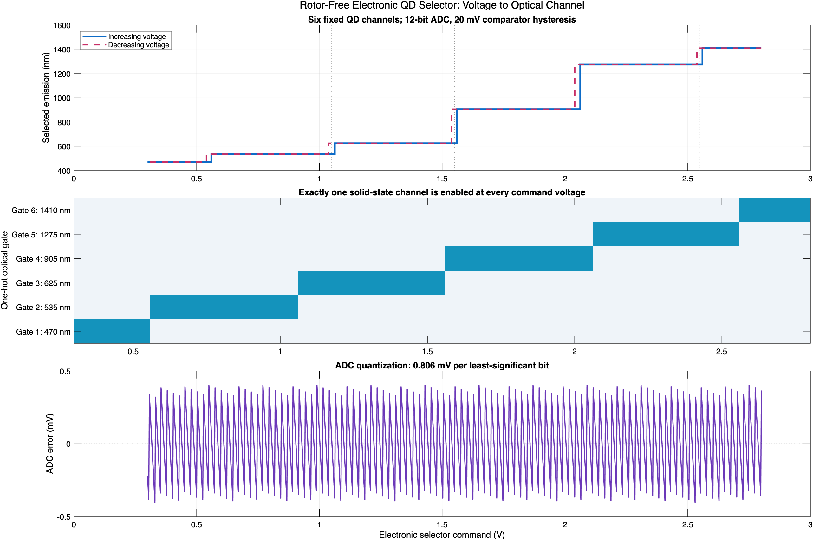

# QD voltage-selected dual conversion system

This deliverable extends the original SWIR-to-visible computational
spectrometer with a second, passive UV-to-visible/NIR down-conversion path.
Both paths are attached in `QDDualConversionSystem.slx`, while
`QDVoltageTunableDownconverter.slx` provides a focused model of the new path.

## Quick start

Run from this folder in MATLAB R2026a with Simulink:

```matlab
initQDVoltageTunableDualConverter(true);
openQDDualConversionSystem;
```

In the combined model:

- Set **Conversion Mode Switch** to `0: SWIR UP` for the powered
  1200-1700 nm to visible path.
- Set it to `1: UV DOWN` for the passive 280-420 nm to visible/NIR path.
- Move **Selector Voltage Slider** to choose a down-conversion channel.

Programmatic control is also available:

```matlab
setQDConversionMode("downconversion");
setQDSelectorVoltage(2.3); % electronically selects the 1275 nm channel
sim("QDDualConversionSystem");
```

To open only the new branch:

```matlab
openQDVoltageTunableDownconverter;
```

To reproduce the validation and figures:

```matlab
demo = runQDDownconversionDemo;
selectorDemo = runQDElectronicSelectorDemo;
downReport = runQDDownconversionTests;
upReport = runQDUpconversionTests;
```

## Electronic voltage map

| Selector voltage | Fixed film | Nominal emission |
|---:|---|---:|
| 0.3 V | CdS/ZnS blue film | 470 nm |
| 0.8 V | InP/ZnSe/ZnS green film | 535 nm |
| 1.3 V | InP/ZnSe/ZnS red film | 625 nm |
| 1.8 V | InAs/InP/ZnSe/ZnS NIR-I film | 905 nm |
| 2.3 V | InAs/ZnSe NIR film | 1275 nm |
| 2.8 V | InAs/ZnSe extended-NIR film | 1410 nm |

The scalar voltage is read by an ADC/window decoder that drives an analog
multiplexer, electronic shutter, or electro-optic gate bank. It routes UV light
to one fixed-emission film with no moving parts. It does **not** imply that one
passive QD film can sweep from 470 to 1410 nm under a few volts. The optional
QCSE shift is zero by default and remains separate from channel selection.

```text
Vselect -> ADC / window comparators -> one-hot 1-of-6 decoder
        -> solid-state optical gate -> selected fixed-emission QD film
```

The default decision thresholds are the midpoints `0.55, 1.05, 1.55, 2.05,
2.55 V`; therefore a continuously adjustable slider resolves to the nearest
calibrated channel. The delivered decoder models a 12-bit, 3.3 V ADC
(`0.806 mV/LSB`), 20 mV comparator hysteresis, and an exact one-hot gate
output. Hardware should use measured thresholds and a break-before-make gate
driver so two optical paths are not active together. The selector voltage is
a control signal, not the electric field across one QD film.

The decoder exposes two workspace signals in each model:

- `qdDownElectronicGatesSim` / `qdDualElectronicGatesSim`: six-element one-hot
  gate vector;
- `qdDownDecoderTelemetrySim` / `qdDualDecoderTelemetrySim`: command voltage,
  ADC voltage, channel index, channel setpoint, nominal emission wavelength,
  and distance to the nearest threshold.



## What the new path computes

The incoming 280-420 nm spectrum is sampled by 12 wavelength-selective UV
filter pixels at five sequential electro-absorption bias states. These 60
spatial measurements excite the selected QD film. The detector preserves the
spatial channel identity, and a nonnegative regularized inverse reconstructs
the original 36-bin UV spectrum.

The emitted spectrum itself is also synthesized on a 420-1800 nm grid. A
dichroic splitter routes shorter wavelengths to a silicon CCD and longer NIR
wavelengths to an InGaAs array. This is necessary because a silicon CCD cannot
measure the 1275 and 1410 nm channels.

The original up-conversion path remains unchanged: a PbS CQD photodiode drives
a visible QD emitter, and external electrical power supplies the anti-Stokes
energy before silicon-CCD detection and SWIR reconstruction.

## Verified default behavior

- Down-conversion computational response: rank 36/36 at every channel.
- Worst response condition number: below 5.3.
- Noisy UV reconstruction correlation: above 0.999 at every channel.
- Passive photon yield and optical energy efficiency: at most one.
- Default demo: no computational-detector saturation.
- New down/dual regression suite: 13/13 passing.
- Inherited up-conversion regression suite: 12/12 passing.
- Both new SLX files pass close/reopen/update/simulate round trips.
- Dashboard voltage slider and mode switch remain bound after save/reload.
- Both generated models contain zero `RotarySwitchBlock` instances.
- Every ADC setpoint, threshold direction, hysteresis hold, and one-hot gate
  output is regression tested.

See `QD_DOWNCONVERSION_TEST_RESULTS.txt`,
`QD_UPCONVERSION_TEST_RESULTS.txt`, and
`QD_DOWNCONVERSION_DEMO_RESULTS.txt` for the exact generated results.

## Calibration boundary

The supplied film absorptance, PLQY, extraction, linewidth, filter response,
detector QE, dark-current, and read-noise curves are physically constrained
synthetic defaults. They are useful for architecture and algorithm work, but
they are **not** calibrated hardware predictions.

Before using the model quantitatively, replace the defaults with measured:

1. UV filter transmission versus wavelength and scan bias;
2. film absorptance, emitted spectrum, PLQY, and extraction versus operating
   temperature and optical irradiance;
3. selector voltage-window thresholds, settling, cross-talk, and hysteresis;
4. silicon and InGaAs spectral response, dark current, read noise, cross-talk,
   and full-well behavior; and
5. the complete end-to-end response matrix and dark frames.

Do not infer output safety, component lifetime, or regulatory compliance from
the default photon counts.

## Main files

- `QDDualConversionSystem.slx` — attached dual-path electronic model.
- `QDVoltageTunableDownconverter.slx` — focused down-conversion model.
- `QDUpconversionCCDSpectrometer.slx` — retained original model.
- `qdDownconversionConfig.m` — films, selector, filter array, and detector.
- `qdBuildDownconversionResponse.m` — passive optical and inverse operators.
- `qdDecodeSelectorVoltage.m` — ADC, thresholds, hysteresis, and one-hot logic.
- `qdElectronicSelectorDecoderSFunction.m` — explicit Simulink decoder block.
- `simulateQDDownconversion.m` — forward/noise/reconstruction API.
- `initQDVoltageTunableDualConverter.m` — Simulink workspace initialization.
- `setQDSelectorVoltage.m`, `setQDConversionMode.m` — programmatic controls.
- `setQDRotorVoltage.m` — compatibility alias for older scripts only.
- `runQDDownconversionDemo.m` — voltage-channel sweep and figures.
- `runQDElectronicSelectorDemo.m` — ADC, hysteresis, and one-hot gate sweep.
- `runQDDownconversionTests.m` — physics and Simulink regression tests.
- `DOWNCONVERSION_MODEL_CARD.md` — equations, scope, and limitations.

## Architecture references

- InAs/InP/ZnSe/ZnS NIR emitters and QLEDs spanning roughly 700-1700 nm:
  https://www.nature.com/articles/s41467-025-57746-1
- RoHS-compliant InAs/ZnSe QLEDs at 1007-1410 nm:
  https://doi.org/10.1021/acsenergylett.5c03820
- Electric-field behavior and practical limits of CQD Stark shifts:
  https://pmc.ncbi.nlm.nih.gov/articles/PMC6814376/
- Voltage-dependent spectral mixing in a multi-emitter device:
  https://www.nature.com/articles/s41467-020-16659-x
- Existing powered CQD up-conversion architecture:
  https://www.nature.com/articles/s41928-020-0388-x

Material names are design candidates, not fabrication instructions. Any real
device needs material-specific toxicology, encapsulation, optical-exposure,
and end-of-life review.
