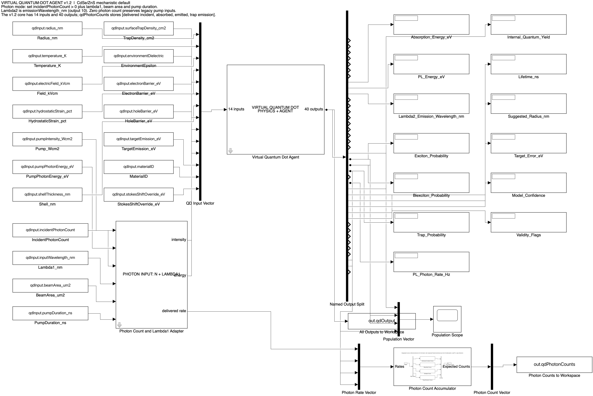

# QD IR-to-Visible CCD Spectrometer + Quantum-Dot Digital Twin

This package now contains two runnable MATLAB/Simulink models:

- `QDUpconversionCCDSpectrometer.slx`: the new 1.2–1.7 µm input → powered
  CQD visible conversion → CCD → computational reconstruction system.
- `VirtualQuantumDotAgent.slx`: the existing single-dot physics and population
  digital twin, preserved with its stable 14-input/40-output contract.

The quantum-dot core is agent-ready numerical software, not an autonomous AI
agent. Core version 1.5.1 adds and corrects a deterministic real-sample observation
layer for size polydispersity, measured radius histograms, instrument
broadening, photon collection, detector quantum efficiency, dark counts and
read noise. It retains the v1.4 physics-constrained ID-3/ID-4 learners and the
stable 14-input/40-output Simulink contract. It was built and tested in
**MATLAB R2026a Update 4**.
For the shortest statement of measured error levels and applicability, read
`ACCURACY_SUMMARY.md`.



## Start with the new IR-to-visible CCD spectrometer

In MATLAB, make this package folder current and run:

```matlab
openQDUpconversionCCDSpectrometer
```

The Simulink chain is explicit:

```text
incoming SWIR spectrum
  -> bias-tuned PbS CQD photodiode/sensitizer
  -> electrically powered CdSe/ZnS visible QD emitter
  -> wavelength-dependent silicon CCD
  -> nonnegative regularized spectral reconstruction
```

Run the reproducible MATLAB demonstration and tests with:

```matlab
result = runQDUpconversionDemo;
report = runQDUpconversionTests;
```

Change the input without rebuilding:

```matlab
cfg = qdUpconversionSpectrometerConfig;
lambda = cfg.inputWavelength_nm;
photons = 2e6*exp(-4*log(2)*((lambda-1510)/35).^2);
setQDSpectralInput(photons);
sim('QDUpconversionCCDSpectrometer');
```

The supplied detector figures describe a direct bias-tuned CQD/ROIC detector;
they do not contain a visible-light conversion or CCD stage. The new model
implements the user's requested architecture instead. Its voltage-powered
photodiode-to-QLED conversion is physically distinct from ordinary passive PL,
which cannot convert SWIR photons to visible photons.

The delivered response matrix and 1% peak photon conversion efficiency are
synthetic design defaults. Replace them with an end-to-end monochromator/CCD
calibration for hardware prediction:

```matlab
cfg = qdApplyMeasuredSpectralCalibration(cfg,lambdaMeasured,Dmeasured, ...
    'DarkElectrons',darkMeasured, ...
    'Label','device/date/temperature/irradiance');
```

Read `SPECTROMETER_MODEL_CARD.md` for units, equations, calibration scope, and
limitations. Numerical grid spacing is not claimed as physical spectral
resolution.

## Start the original single-dot digital twin

In MATLAB, make this package folder the current folder, then run:

```matlab
openVirtualQuantumDotAgent
```

Press **Run** in Simulink. The default CdSe/ZnS dot produces approximately:

- absorption transition: 1.968 eV
- PL transition: 1.943 eV (638.19 nm)
- prompt free-exciton lifetime: 14.42 ns
- instantaneous decay-flux quantum yield: 0.644
- model confidence: 0.92
- validity flags: 0 (inside the implemented validity checks)

Change inputs and rerun without rebuilding the model:

```matlab
setQDInput('radius_nm',2.8, ...
           'temperature_K',325, ...
           'electricField_kVcm',50, ...
           'pumpIntensity_Wcm2',10, ...
           'targetEmission_eV',2.0);
sim('VirtualQuantumDotAgent');
```

The model callback preserves your edited `qdInput` values. Run
`initVirtualQuantumDotAgent` only when you want to restore all defaults.

## Use it as an agent tool

Call the physics engine directly:

```matlab
r = simulateQD( ...
    'radius_nm',3.0, ...
    'temperature_K',300, ...
    'electricField_kVcm',0, ...
    'pumpIntensity_Wcm2',0.01, ...
    'targetEmission_eV',2.0);

r.plEnergy_eV
r.emissionWavelength_nm
r.internalQuantumYield
r.spectrum
r.warnings
```

### Photon-count interface (v1.2)

The MATLAB interface can also describe a finite optical pulse with four scalar
fields:

| Field | Meaning |
|---|---|
| `incidentPhotonCount` | photons incident on the specified beam area during the pulse; `0` selects the legacy intensity/energy interface |
| `inputWavelength_nm` | incident wavelength, \(\lambda_1\), in nm |
| `beamArea_um2` | illuminated area in \(\mu\text{m}^2\) |
| `pumpDuration_ns` | square-pulse duration in ns |

For example:

```matlab
inputs = qdDefaultInputs;
inputs.incidentPhotonCount = 1e5;
inputs.inputWavelength_nm = 405;
inputs.beamArea_um2 = 100;
inputs.pumpDuration_ns = 10;
r = simulateQD(inputs);
```

When `incidentPhotonCount > 0`, the interface maps \(\lambda_1\) to the legacy
physics input

```text
pumpPhotonEnergy_eV = 1239.841984 / inputWavelength_nm
```

and maps photon count, area and duration to a uniform square-pulse intensity:

```text
pumpIntensity_Wcm2 = incidentPhotonCount * photonEnergy_J ...
                     / ((beamArea_um2 * 1e-8) * (pumpDuration_ns * 1e-9))
```

Thus the 14-input physics engine remains the source of the rates and
populations. With `incidentPhotonCount = 0`, `pumpIntensity_Wcm2` and
`pumpPhotonEnergy_eV` retain their legacy meanings and the photon-pulse fields
do not override them.

The second wavelength, \(\lambda_2\), is the existing
`emissionWavelength_nm` result and Simulink output 10. It is calculated from
the dot's `plEnergy_eV`; it is mostly determined by dot material, radius,
temperature, field, strain and interface physics. It is not a direct
wavelength conversion of \(\lambda_1\). Changing \(\lambda_1\) primarily
changes excitation and population dynamics unless other dot inputs also
change.

The pulse result reports expected absorbed, emitted and trap-emission photon
counts using an exact augmented Markov exponential on every constant-input
interval. These are per-dot expectation values, so
fractional counts are meaningful; they are not integer photon-event records.
The fixed 40-element Simulink output ordering is unchanged. Simulink also
writes a separate four-value `qdPhotonCounts` structure ordered as
`[delivered incident, absorbed, emitted, trap emission]`; run `qdPhotonCountNames` for the
exact names.

Ask the inverse-design agent for a core radius:

```matlab
solution = optimizeQDTarget(2.0, ...
    'Temperature_K',300, ...
    'RadiusBounds_nm',[1.5 10]);
```

The verified default search returns a radius of about **2.59717 nm** for a
2.000 eV PL target, with a numerical target error near 1 neV under this model.
That tiny number is solver error, not experimental uncertainty.

## Real-sample ensemble and detector layer (v1.5)

`simulateQD` represents one idealized dot. `simulateQDEnsemble` now propagates
a physical **number-weighted radius distribution** through that same tested
single-dot engine. It mixes every member on a common energy grid, converts the
mixture once to wavelength space, applies an optional Gaussian instrument
response and estimates detector count statistics.

Use a lognormal radius distribution:

```matlab
inputs = qdAccurateCdSeInputs(2.8);
inputs.stokesShiftOverride_eV = 0.030;
ensemble = simulateQDEnsemble(inputs, ...
    'RadiusCV',0.06, ...
    'QuadratureOrder',21, ...
    'InstrumentFWHM_eV',0.015);

ensemble.plPeakWavelength_nm
ensemble.plFWHM_nm
ensemble.validity.opticalCalibrationWeightFraction
```

Or supply measured TEM-style number fractions directly:

```matlab
ensemble = simulateQDEnsemble(inputs, ...
    'Radii_nm',[2.6 2.8 3.0 3.2], ...
    'NumberFractions',[0.15 0.45 0.30 0.10]);
```

For pulse-integrated source and detector counts, specify a duration and the
illuminated dot count:

```matlab
inputs.incidentPhotonCount = 1e6;
inputs.inputWavelength_nm = 405;
inputs.beamArea_um2 = 100;
inputs.pumpDuration_ns = 1;
observed = simulateQDEnsemble(inputs, ...
    'RadiusCV',0.06,'Duration_ns',5,'NumberOfDots',1e5, ...
    'CollectionEfficiency',0.03,'OpticalTransmission',0.70, ...
    'DetectorQuantumEfficiency',0.80,'DarkCountRate_Hz',50, ...
    'ReadNoiseElectronsRMS',1.5,'DetectorPixelCount',64);

observed.detector.signalPhotoelectronCountExpected
observed.detector.totalNoiseStd
observed.detector.signalToNoiseRatio
```

The default ensemble duration is zero for fast static spectra. Absolute counts
require an explicit `NumberOfDots`; it is never inferred from beam area.
Trap-emission counts remain a separate unresolved spectral component because
the core model does not contain a defensible trap-emission wavelength.

The first implementation assumes independent dots under a uniform, undepleted
pump. `pumpDepletionIndicator` and
`opticallyThinApproximationLikelyValid` warn when multiplying per-dot absorbed
counts by the dot number is no longer self-consistent. If no finite incident-
photon budget is supplied, both fields return `NaN` and
`pumpDepletionAssessment` says that depletion was not assessed. This diagnostic
is a photon-budget ratio, not an optical-depth calculation. It does not yet model
Beer–Lambert attenuation, reabsorption, inter-dot energy transfer, blinking or
detector dead time. Run `runQDEnsembleDemo` for the supplied comparison plot.

## Physics + small-data ML

Large neural models were benchmarked but not deployed. The usable labeled sets
are small (seven protocol-specific optical points and 34 kinetic rows with only
21 distinct PL energies), so grouped validation selected lower-variance,
physics-constrained learners.

The deployed ID-4 kinetic model learns measured total lifetime and PLQY with a
cubic ridge regression, then derives `kr = PLQY/tau` and
`knr = (1-PLQY)/tau`. This guarantees nonnegative, mutually consistent rates.
Its eight frozen coefficients run in both MATLAB and Simulink without a deep-
learning runtime. An ID-3 bilinear Auger-lifetime learner is likewise deployed
only inside the convex hull of the 2026 cation-exchange measurements.

The standard `simulateQD`/Simulink optical path retains the Brennan-2017 ID-4
source table. For a declared synthesis protocol, use the optional MATLAB
adapter:

```matlab
inputs = qdCalibratedMaterialInputs(4,4.3); % cube edge, nm
h = predictQDHybrid(inputs,'OpticalProtocol','mondal2019');
b = benchmarkQDHybridModels;
```

`OpticalProtocol` may be `brennan2017`, `mondal2019`, or `unknown` (default).
The Mondal adapter applies a learned −0.066715909 eV absorption residual only
for bare/reference-boundary cubes of edge 3.0–6.2 nm at 293–300 K. `unknown`
returns the robust midpoint of the two protocol estimates. The adapter never
changes PL or `lambda2`; there are too few paired same-protocol PL data to fit
that correction honestly. IDs other than 4 and out-of-scope inputs fall back
to the normal physics/empirical result.

The Statistics and Machine Learning Toolbox is required to regenerate the
candidate benchmark (GP, ensemble and compact neural regressors). It is not
required by the frozen deployed learners.

## Inputs

All values are scalar. Interfaces use convenient laboratory units; the engine
converts them to SI internally.

| # | Input | Default | Unit / meaning |
|---:|---|---:|---|
| 1 | `radius_nm` | 3.0 | core radius, nm |
| 2 | `temperature_K` | 300 | temperature, K |
| 3 | `electricField_kVcm` | 0 | field magnitude/sign along one axis, kV/cm |
| 4 | `hydrostaticStrain_pct` | 0 | hydrostatic strain trace, %, positive=tensile |
| 5 | `pumpIntensity_Wcm2` | 0.010 | optical irradiance, W/cm² |
| 6 | `pumpPhotonEnergy_eV` | 3.5424 | pump photon energy, eV (about 350 nm) |
| 7 | `shellThickness_nm` | 1.0 | shell/tunnel barrier thickness, nm |
| 8 | `surfaceTrapDensity_cm2` | 1e10 | surface traps, cm⁻² |
| 9 | `environmentDielectric` | 2.25 | outside relative permittivity |
| 10 | `electronBarrier_eV` | 0 | electron offset; 0 uses preset (0.9 eV for CdSe/ZnS) |
| 11 | `holeBarrier_eV` | 0 | hole offset; 0 uses preset (0.6 eV for CdSe/ZnS) |
| 12 | `targetEmission_eV` | 2.0 | target used by the radius recommender |
| 13 | `materialID` | 1 | 1 CdSe/ZnS mechanistic; 2 InP/ZnSe; 3 PbS/CdS; 4 CsPbBr3; 5 scoped bare-CdSe empirical preset |
| 14 | `stokesShiftOverride_eV` | 0 | explicit absorption-to-PL shift; 0 uses the material preset |

Material 1 is the mechanistic benchmark baseline. It has not been fitted to
a private fabrication batch or certified as universally predictive. Material
IDs 2–4 use published optical anchors inside explicit source envelopes and
mechanistic deltas for field, strain, dielectric and barrier changes. They
report `modelTier = 2`; this identifies the empirical-anchor hybrid and is not
a claim of atomistic fidelity.

| ID | Calibrated baseline and source size | Valid source envelope | Not validated |
|---:|---|---|---|
| 2 — InP | Almeida et al. (2023) bare-core absorption law, `Eabs = 1.33 + 1.219/V^0.251` eV, where `V` is an approximately regular-tetrahedral core volume | `V = 1–10 nm^3`, 293–303 K, zero field/strain, reference dielectric/barriers, and shell `<=0.05 nm` (numerical bare-core tolerance) | PL/Stokes shift, all kinetics, and any resolved ZnSe shell |
| 3 — PbS | Moreels et al. (2009) first-exciton absorption law; separate Stylianou et al. (2026) biexciton Auger learner | Optical: `d = 3.9–13.3 nm` near ambient, with conservative Justo cation-exchange transfer at core `d = 3.9–5.8 nm`, shell `0.5–1.25 nm`. Auger: core `5.32–7.63 nm`, shell `0–0.84 nm`, outer diameter/shell point inside the measured convex hull, 293–303 K | PL/Stokes, total lifetime, radiative/nonradiative rates, and shell-induced spectral shifts; Auger calibration is provisional and protocol-specific |
| 4 — CsPbBr3 | Brennan et al. (2017) nanocube absorption/PL/Stokes table | cube edge `3–12.8 nm`, 250–300 K, zero field/strain, reference dielectric/barriers, and no shell | Extrapolated optics; kinetics outside the separately tested ambient PL-energy range |

The engine still accepts one scalar `radius_nm`. For a regular tetrahedron of
edge `a`, `V = a^3/(6*sqrt(2))` and the engine uses the equal-volume radius
`r = (3*V/(4*pi))^(1/3)`. For a cube of edge `L`, it uses
`r = (3/(4*pi))^(1/3)*L`. PbS remains spherical with `r = d/2`. Use the helper
to avoid applying the wrong size convention:

```matlab
inP = qdCalibratedMaterialInputs(2,2.5);       % tetrahedron edge, nm
pbS = qdCalibratedMaterialInputs(3,6.0);       % PbS core diameter, nm
csPbBr3 = qdCalibratedMaterialInputs(4,8.0);   % cube edge, nm
result = simulateQD(csPbBr3);
result.calibration
```

For IDs 2 and 3, these sources do not calibrate PL. A measured
`stokesShiftOverride_eV` is required to make lambda2 sample-specific and clear
the PL/Stokes scope warning. ID-2 kinetics and most ID-3 kinetics remain
generic; ID 3 has only the separately gated biexciton Auger calibration. ID 4
uses the source-tabulated PL/Stokes relation and the measured
near-ambient slope of `+0.224 meV/K` over 250–300 K. Its ambient kinetics are
calibrated separately as described below.

Material 5 is an effective optical interpolation fitted to the mean of three
published bare-CdSe sizing equations over 3–8 nm diameter at 300 K. Its fitted
masses, permittivity, and barriers are not new bulk-property measurements.
The four photon-pulse fields documented above are an alternate MATLAB
interface that is reduced to inputs 5 and 6 before the physics step; they are
not additional independent physical degrees of freedom in the core model.

## Outputs

The subsystem emits a fixed 40-element vector. Use `qdOutputNames` for exact
ordering or `qdUnpackOutputs` to obtain a named structure.

| Group | Outputs |
|---|---|
| Electronic structure | bulk gap, electron/hole confinement, exciton binding, polarization, Stark and strain shifts, absorption/PL energy, wavelength, overlap |
| Optical response | absorption cross section, generation rate, PL photon rate, absorption event rate, trap-emission photon rate, normalized absorption/PL spectra through `simulateQD` |
| Kinetics | radiative, nonradiative, Auger, trap capture, thermal escape and tunneling rates; lifetime and quantum yield |
| State | ground, exciton, biexciton and trap probabilities; mean exciton number |
| Electrical | charging energy and WKB tunneling rate |
| Agent | suggested radius and signed target error |
| Diagnostics | model confidence, validity flags, finite-well residuals, probability residual and fidelity tier |

Run `qdOutputNames` in MATLAB to print all 40 exact field names.

## Physics implemented

The default model is a parameterized effective-mass/master-equation digital twin:

1. Varshni temperature-dependent bulk gap.
2. Finite spherical electron and hole barriers with BenDaniel–Duke interface
   matching and bracketed ground-state root solving.
3. Electron-hole Coulomb attraction with an exact two-region radial-state
   overlap (the Coulomb coefficient itself remains an effective approximation).
4. First-order dielectric mismatch/polarization correction.
5. Quadratic quantum-confined Stark shift and field-reduced overlap.
6. Hydrostatic deformation-potential strain shift and geometric dilation.
7. Measured-size-law optical absorption at 350 nm plus an energy-dependent
   pump threshold/tail.
8. Source-scoped empirical optical anchoring for InP, PbS and CsPbBr3. The
   reference absorption replaces the nominal zero-perturbation transition;
   mechanistic field, strain, dielectric and barrier changes enter as deltas.
9. Radiative, nonradiative, phonon, surface trap, thermal escape, biexciton
   Auger and WKB tunneling channels, including the scoped ID-3 Auger and ID-4
   lifetime/PLQY learners.
10. A four-state probability master equation `[p0,pX,pXX,pTrap]`. A matrix
   exponential propagates probabilities, while an augmented reward system
   integrates absorbed, emitted, and trap-emission events exactly per interval.
11. A local-sensitivity inverse-design controller that suggests the next radius
    for the requested emission energy.

The analytic infinite-barrier Brus implementation is kept separately in
`qdBrusReference.m` for exact regression testing.

## Accuracy and honest limits

“Most accurate” is material- and sample-specific. This package is a strong
research baseline, not an atomistically exact representation of every dot. Its
CdSe/ZnS preset incorporates finite barriers, dielectric, temperature, strain,
field and kinetic corrections that the simple Brus equation omits. For
quantitative prediction on a real batch, replace/fix the band offsets, trap
density, Stokes shift and kinetic rates using measured absorption, PL and
time-resolved PL data.

The confidence/flag outputs expose many—but not all—extrapolations. In particular, the
effective-mass approximation loses accuracy near atomic radii; the weak-field
Stark approximation should be replaced by Hamiltonian diagonalization at large
`eFR`; nonspherical/wurtzite dots need anisotropic multiband k·p, tight binding,
or atomistic calculations. Full limitations and flag meanings are in
`MODEL_CARD.md`.

Single-dot photon-count mode assumes a square pulse and a uniform beam over
`beamArea_um2`. Version 1.5 can combine independent dots only when
`NumberOfDots` is stated. Its detector layer includes collection efficiency,
optical transmission, detector quantum efficiency, dark-count expectation,
Poisson signal/dark variance and optional read noise. Population saturation
and the engine's numerical generation/rate caps make very-high-fluence results
qualitative. Pump depletion, integer event histories, antibunching and blinking
still require a coupled stochastic propagation/detection model.

Shell thickness currently changes tunneling, trapping, and Auger kinetics, but
does not create a full three-region core/shell/environment eigenproblem. The
electronic energies use a two-region effective barrier. Therefore changing only
`shellThickness_nm` does not by itself predict a shell-induced absorption/PL
shift. Quantitative core/shell design requires fitted offsets or a layered
radial Hamiltonian. The model also assumes a spherical single-band dot; it is
not automatically transferable to rods, platelets, perovskite phase changes,
type-II structures, or strongly nonparabolic PbS without new calibration.

## Validation and reproducibility

Run:

```matlab
report = runQDTests;
```

The delivered build passed **20/20 tests** in R2026a, including:

- CODATA/Brus analytic golden values
- finite-barrier result, shallow-bound-state roots, and probability conservation
- radius and temperature limiting behavior
- even-in-field quadratic Stark response
- autonomous inverse radius search
- actual Simulink diagram update and execution
- preservation and physical effect of edited input variables
- legacy-equivalent photon-interface fallback and exact unit conversion
- exact zero/sub-step/truncated pulse accounting and Markov-reward integration
- pump-edge continuity and energy/wavelength spectrum-Jacobian conservation
- explicit Stokes-shift propagation and strict input validation
- calibrated material-5 scope and extrapolation flags
- Simulink photon inputs, lambda2 output, and count accumulator

See `VALIDATION_RESULTS.txt` and `QDValidationResults.mat` for the frozen run.
`VALIDATION_MANIFEST.json` records the MATLAB release, pass counts, declared
calibration scope, and SHA-256 hashes of the tested model and core sources.
Use `runVirtualQuantumDotDemo` to regenerate the supplied dynamics and spectra.

Run `runMultiMaterialCalibrationTests` for the v1.4 material-ID suite. The
delivered build passed **22/22 tests** on 2026-08-27, including the stable
14-input/40-output interface, source equations and geometry conversions,
scope/flag behavior, photon-count/lambda1 compatibility, ID-4 optical and
kinetic grouped evaluation, ID-3 whole-series Auger validation, 10,001-point
kinetic physicality/rate closure, the protocol adapter, and Simulink/direct-
engine agreement for IDs 2–4. See
`MULTIMATERIAL_CALIBRATION_RESULTS.txt` for the frozen report. The existing
**20/20** core/Simulink and **7/7** CdSe empirical-workflow suites also remain
passing. `runQDHybridTests` adds **10/10** tests for disjoint development/
frozen sets, deterministic model selection, exact hybrid metrics, protocol
boundaries/fallbacks, unchanged lambda2, and the ID-3 convex-hull gate.

Version 1.5.1 adds `runQDEnsembleTests`, which passes **14/14** tests for the
zero-dispersion single-dot limit, analytic lognormal radius moments and
R-cubed absorption area, measured discrete fractions, deterministic
quadrature, energy/wavelength spectral conservation, instrument broadening,
detector/noise arithmetic, optically-thin diagnostics, bounded-distribution
conditioning, zero-weight invariance, calibration-scope coverage, population
physicality and strict input rejection. Across the five delivered suites, the
frozen package therefore passes **73/73 checks**.

Two extra tests quantify known out-of-scope failures instead of hiding them:
one geometry-mismatched InP/ZnSe sample has signed absorption/PL errors of
-206.795/-96.795 meV, and an independent thick-shell PbS/CdS series has
134.996 meV PL RMSE and 0.17455 electron-hole-overlap RMSE. Both scenarios
raise observable/geometry warnings and are not in-scope calibration claims.

### Calibrated ID-4 held-out errors

The CsPbBr3 optical baseline is the Brennan et al. cube table for edges
3–12.8 nm, with its measured 250–300 K slope. An external cross-source/protocol
comparison to the Chemical Science absorption series gives **69.587 meV RMSE** with
**+64.909 meV bias**. Cross-protocol PL anchors have **43.6757 meV RMSE**.

The 293–303 K kinetic learner uses 25 development rows (16 distinct PL-energy
groups) from the 34-row Abbas et al. source. Ridge strength was selected only
with leave-one-energy-group-out development validation; nine rows in five
predeclared energy groups were then evaluated. Frozen errors are
**0.0145593 ns^-1** for radiative rate, **0.0103094 ns^-1** for nonradiative
rate, **0.0896423 ns** for total lifetime, **0.180421 ns** for radiative
lifetime, and **3.48661 percentage points** for PLQY. These metrics are
conditional on PL energy, not an end-to-end size-to-kinetics accuracy claim.

For the Mondal-2019 absorption protocol, four sizes were used only for model
selection. A constant residual won with 0.0118791 eV development LOOCV RMSE.
On three untouched sizes, the Brennan baseline RMSE is 0.0725149 eV and the
protocol-adapted RMSE is **0.0370127 eV** with −0.00421591 eV bias. This 49%
reduction is batch/protocol-specific; it is not a universal correction or a
formal confidence interval. The full seven-point 0.069587 eV figure above
remains the unadapted external-dataset check.

### Scoped ID-3 Auger accuracy

The 2026 PbS/CdS Auger learner uses 13 rounded lifetime rows from three
reported synthesis series. Holding out each entire series gives **8.9463 ps
RMSE**, 6.5183 ps MAE, and Q² = 0.9714, versus 100.688 ps RMSE for the old
generic size/shell law on the same rows. Only the biexciton Auger rate is
calibrated, at the source's low-occupancy transient-absorption condition. The
three-series evidence base is small, so the model is labeled provisional and
is never extrapolated outside its convex geometry envelope.

### Published real-world comparison and calibrated CdSe option

Run `validateAgainstRealCdSe(400)` to characterize the mechanistic material-1 first absorption transition
with three published bare-core CdSe relationships from separate studies: Yu et al.,
Jasieniak et al., and de Mello Donega/Koole. Over 3–8 nm diameter, the delivered
finite-barrier engine has energy RMSE values of 43.84, 27.79, and 43.90 meV,
respectively; its RMSE against the three-curve mean is 37.80 meV. Against Yu,
the RMSE is 21.98 meV over 4–8 nm, versus 445.03 meV for the infinite-barrier
Brus approximation over 3–8 nm.

The same workflow checks intrinsic radiative lifetime against the published
de Mello Donega/Koole energy-rate relation. Its 3–8 nm RMSE is 9.55 ns and the
mean relative error is -27.97%. This check uses `1/radiativeRate_Hz`, not the
trap-limited `effectiveLifetime_ns`.

For a new CdSe input with explicit error bands:

```matlab
inputs = qdAccurateCdSeInputs(3.0); % radius 3 nm, diameter 6 nm
prediction = predictQDWithError(inputs,400);
```

For the highest delivered room-temperature bare-CdSe absorption consistency,
use material 5 through `qdAccurateCdSeInputs`. Run
`validateCalibratedCdSePreset` to regenerate its 3–8 nm report. On the dense
0.25 nm grid, its calibration RMSE is **0.371 meV** versus the mean of the
three source equations and **0.115 nm** in wavelength; RMSE versus the
individual Yu, Jasieniak, and Donega/Koole equations is 5.57, 10.85, and
9.97 meV. These are training/calibration residuals, not held-out experimental
accuracy. The fitted source equations validate absorption peak energy only.
They do not validate PL wavelength, quantum yield, traps, Auger dynamics, or
photon counts. Set `stokesShiftOverride_eV` from paired absorption/PL data when
lambda2 accuracy matters.

See `REAL_WORLD_VALIDATION.md`. The output called `modelConfidence` is a
dimensionless validity score—not a calibrated probability or confidence
interval.

Run `runRealWorldValidationTests` to verify the empirical equations, observable
mapping, scoped benchmark gating, calibrated checkpoint, and lifetime relation.
The delivered workflow passes **7/7 tests** in addition to the 20/20
core/Simulink suite.

## Primary model references

- E. O. Kane/Brus-style effective-mass treatment: L. E. Brus,
  [J. Chem. Phys. 80, 4403 (1984)](https://doi.org/10.1063/1.447218)
- Y. P. Varshni, temperature-dependent semiconductor gaps,
  [Physica 34, 149 (1967)](https://doi.org/10.1016/0031-8914(67)90062-6)
- CdSe 350-nm absorption cross section: Leatherdale et al.,
  [J. Phys. Chem. B 106, 7619 (2002)](https://doi.org/10.1021/jp025698c)
- CdSe size/absorption calibration: Yu et al.,
  [Chem. Mater. 15, 2854 (2003)](https://doi.org/10.1021/cm034081k)
- Separate CdSe size/absorption calibration: Jasieniak et al.,
  [J. Phys. Chem. C 113, 19468 (2009)](https://doi.org/10.1021/jp906827m)
- CdSe size/absorption and radiative-rate relations: de Mello Donega and Koole,
  [J. Phys. Chem. C 113, 6511 (2009)](https://doi.org/10.1021/jp811329r)
- Single-dot Stark polarizability: Empedocles and Bawendi,
  [Science 278, 2114 (1997)](https://doi.org/10.1126/science.278.5346.2114)
- Auger volume scaling: Klimov et al.,
  [Science 287, 1011 (2000)](https://doi.org/10.1126/science.287.5455.1011)
- CdSe pressure/deformation response: Shan et al.,
  [Appl. Phys. Lett. 84, 67 (2004)](https://doi.org/10.1063/1.1638879)
- InP tetrahedral-volume absorption calibration: Almeida et al.,
  [Nano Letters (2023)](https://doi.org/10.1021/acs.nanolett.3c02630)
- PbS first-exciton absorption sizing: Moreels et al.,
  [ACS Nano (2009)](https://doi.org/10.1021/nn900863a)
- PbS/CdS cation-exchange geometry transfer: Justo et al.,
  [J. Phys. Chem. C (2013)](https://doi.org/10.1021/jp406774p)
- PbS/CdS biexciton Auger series: Stylianou et al.,
  [Nano Letters (2026)](https://doi.org/10.1021/acs.nanolett.6c00158)
- CsPbBr3 nanocube absorption, PL and temperature anchors: Brennan et al.,
  [JACS (2017)](https://doi.org/10.1021/jacs.7b05683)
- External CsPbBr3 cross-source optical comparison: Mondal et al.,
  [Chemical Science (2019)](https://doi.org/10.1039/C9SC01339C)
- CsPbBr3 PLQY and time-resolved kinetics: Abbas et al.,
  [Nature Communications (2025)](https://doi.org/10.1038/s41467-025-60848-5)
- Constants: [NIST 2022 CODATA](https://physics.nist.gov/cuu/pdf/wall_2022.pdf)

## Files to keep together

Keep the `.slx` model and all `.m` files in this folder. `qdAgentSFunction.m`
is the interpreted high-fidelity bridge used by Simulink; `qdPhysicsStep.m` is
the physics/master-equation core. The interpreted path was chosen deliberately
so parameter and equation edits do not require a long code-generation compile.
