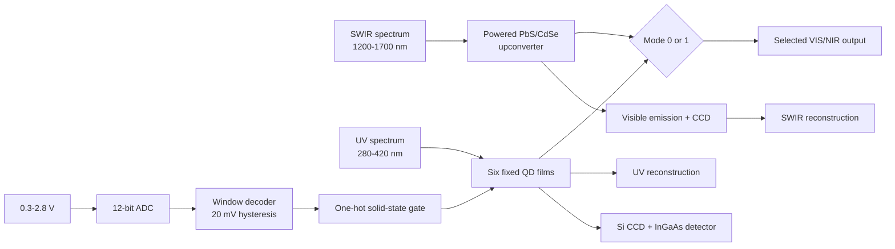

# Architecture

## Combined model

Mode `0` selects powered SWIR upconversion. Mode `1` selects passive UV
downconversion. The combined output grid spans 420-1800 nm, and a photon-
conserving interpolation matrix maps the visible upconversion grid onto it.

## Independent branches

`QDUVDownconverter.slx` calls only `initQDUVDownconverter`; it no longer
initializes or depends on the SWIR branch. `QDSWIRUpconversionSpectrometer.slx`
similarly calls only its own initializer. `QDVoltageSelectedDualConverter.slx`
composes both independent branches.

Every model contains a self-bootstrap callback. A model opened directly from
`models/` locates the package root, runs setup, and then invokes the correct
branch initializer.

Fresh diagrams are generated in `results/figures/`:

- `qd-voltage-selected-dual-converter-diagram.png`
- `uv-downconverter-diagram.png`
- `swir-upconversion-spectrometer-diagram.png`
